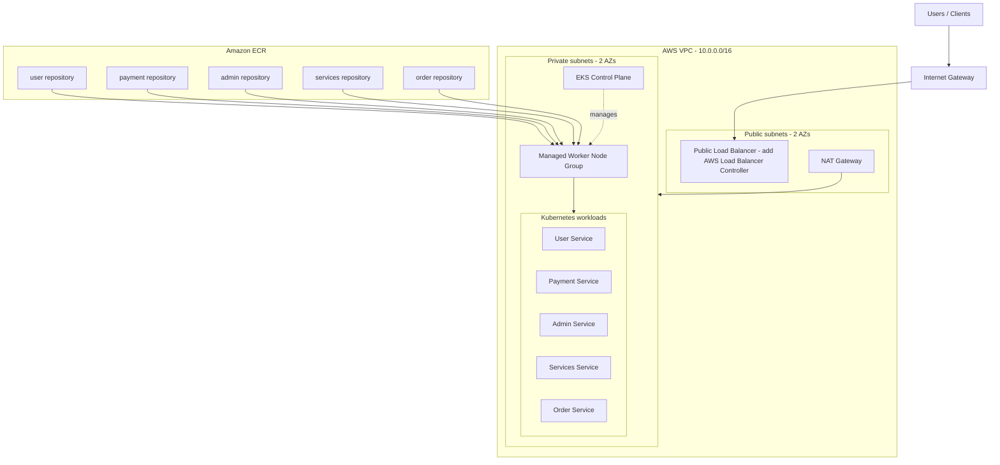

# AWS EKS + ECR: five microservices

This starter provisions:
- A VPC across two Availability Zones
- Public subnets for internet-facing load balancers and private subnets for EKS worker nodes
- One NAT Gateway (lower cost than one NAT Gateway per AZ; not fully AZ-resilient)
- An Amazon EKS cluster with an EKS managed node group
- Five private ECR repositories: `user`, `payment`, `admin`, `services`, `order`
- Kubernetes Deployments and ClusterIP Services for all five microservices

## Architecture



> The five Kubernetes Services are `ClusterIP` (internal-only). The diagram's public load balancer is a future ingress entry point, not created by this Terraform. To expose APIs publicly, install the AWS Load Balancer Controller and create an Ingress, or deliberately change selected Services to `LoadBalancer`.

## Prerequisites

- Terraform >= 1.6
- AWS CLI v2 configured with credentials that can create VPC, IAM, EKS, and ECR resources
- `kubectl`, Docker, `jq`, and `envsubst` (usually from `gettext`)
- An AWS region with at least two available AZs

## 1. Configure

```bash
cd terraform
cp terraform.tfvars.example terraform.tfvars
# Edit region, project name, and node sizing if required.
```

The example uses `ap-south-1` and `t3.medium` workers. This is a learning/dev starting point, not a production sizing recommendation.

## 2. Create infrastructure

```bash
terraform init
terraform fmt -recursive
terraform validate
terraform plan
terraform apply
```

Terraform creates the ECR repositories and EKS infrastructure. It does not create Docker images because your five application source folders and Dockerfiles are specific to your project.

## 3. Connect kubectl

From the `terraform` directory:

```bash
aws eks update-kubeconfig \
  --region "$(terraform output -raw aws_region)" \
  --name "$(terraform output -raw cluster_name)"

kubectl get nodes
```

## 4. Build and push your five images

Expected source layout from the project root:

```text
services/
  user/Dockerfile
  payment/Dockerfile
  admin/Dockerfile
  services/Dockerfile
  order/Dockerfile
```

Run from the project root:

```bash
./scripts/build-and-push.sh
```

The script reads the ECR repository URLs from Terraform outputs. Each Dockerfile must build an image for its own service. The script pushes the tag `latest` by default; set `IMAGE_TAG` to use a version tag:

```bash
IMAGE_TAG=v1.0.0 ./scripts/build-and-push.sh
```

## 5. Deploy to EKS

Run from the project root after connecting `kubectl`:

```bash
./scripts/deploy.sh
kubectl get deployments
kubectl get pods
kubectl get services
```

The manifest template assumes each app listens on port `8080`. Change `containerPort` and `targetPort` in `k8s/microservices.yaml.tpl` if your applications use a different port. It does not assume a health-check URL.

## 6. Useful commands

```bash
kubectl get pods -o wide
kubectl describe pod <pod-name>
kubectl logs deployment/user
kubectl rollout status deployment/payment
kubectl rollout restart deployment/order
```

## Important security and production notes

- EKS API endpoint is public in this starter and protected by AWS IAM authentication. Restrict `cluster_endpoint_public_access_cidrs` to your office/VPN public IP CIDRs before production. Do not use `0.0.0.0/0` for a production admin endpoint.
- Worker nodes are in private subnets. They reach ECR and other internet endpoints through one NAT Gateway. For production, consider one NAT Gateway per AZ or VPC endpoints for ECR (API + DKR), S3, CloudWatch, and STS as appropriate.
- The worker node role has ECR read access. Pushing images uses the AWS identity of the person/CI job running the build script, which needs ECR push permissions.
- Kubernetes Services are internal-only. Add AWS Load Balancer Controller + Ingress, authentication, TLS/ACM, WAF, and DNS as appropriate before internet exposure.
- Replace `latest` with immutable version tags/digests in production. Add CI/CD, image scanning, secrets management (Secrets Manager/External Secrets), PodDisruptionBudgets, autoscaling, monitoring, logging, and backup/DR practices.
- Payment workloads need additional security, compliance, network segmentation, and secret-handling review. Do not put payment credentials in manifests or source control.
- This configuration is a baseline and has not been applied to your AWS account. Review `terraform plan`, quotas, and cost before applying.

## Cost warning

EKS control-plane charges, EC2 worker nodes, NAT Gateway hourly/data processing, EBS, load balancers, and ECR storage can incur charges. A NAT Gateway and two `t3.medium` nodes are not free-tier assumptions. Run `terraform destroy` when finished with a disposable lab:

```bash
cd terraform
terraform destroy
```

Destroying the infrastructure also deletes the ECR repositories and their images because `force_delete = true` is enabled for this learning environment. Remove that setting and empty repositories first if you need to retain images.
